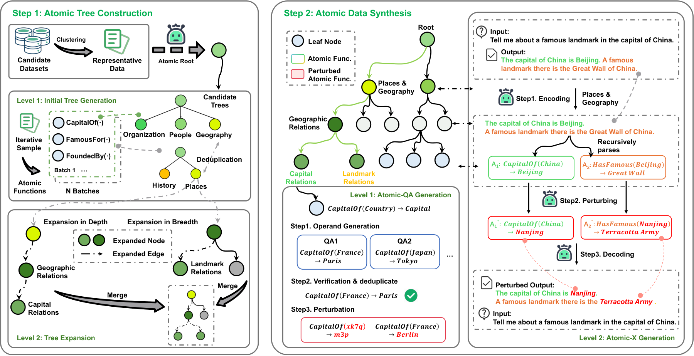
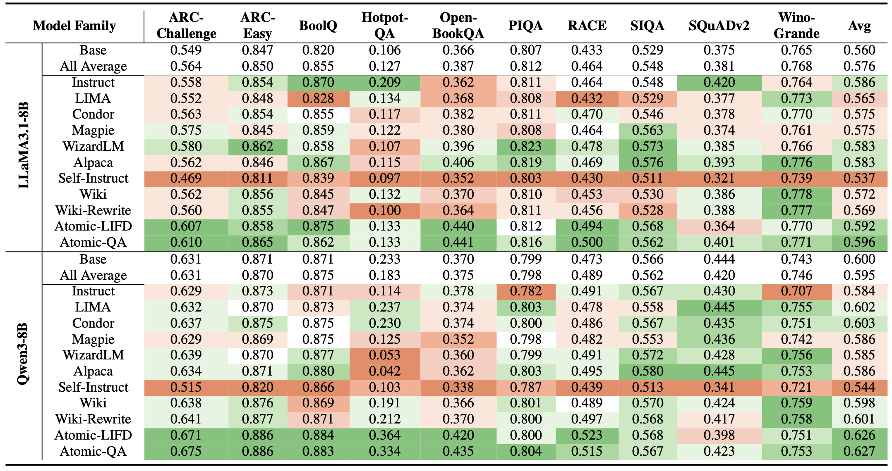

<div align="center">

# ⚛️ ATOM

<h3>Quantifying Error Tolerance in Synthetic Data:<br>An Atomic-level Operand vs. Operator Perturbation Study</h3>

**EMNLP 2026 Findings**

<p align="center">
  <a href="https://arxiv.org/abs/2608.29144"></a>&nbsp;
  <a href="https://huggingface.co/datasets/Lut123/Atomic-QA"></a>
</p>

</div>

ATOM constructs Atomic-QA data around individual operations, `f(x) = y`, and studies two types of synthetic-data perturbation: consistently relabeling operands and outputs, and introducing incorrect operator outputs. This repository provides the Atomic-QA generation, verification, deduplication, export, and perturbation tools.

## ATOM pipeline

**Atomic Tree Operation Modeling (ATOM)** builds a hierarchy of atomic operators, then uses it to synthesize and perturb data. The paper's framework includes Atomic-QA generation and Atomic-X processing of complex samples.

<p align="center">
  
</p>

## Experimental results

Atomic-QA achieves the highest average accuracy among the settings in the table: **59.6%** for LLaMA3.1-8B and **62.7%** for Qwen3-8B, evaluated across ten benchmarks.

<p align="center">
  
</p>

## Dataset

The final Atomic-QA dataset contains **1,370,321 QA records** and is available on [Hugging Face](https://huggingface.co/datasets/Lut123/Atomic-QA). [Download `final_data.json`](https://huggingface.co/datasets/Lut123/Atomic-QA/resolve/main/data/final_data.json?download=true) (375.87 MB).

## Installation

Requires Python 3.10 or newer. Clone the repository to use the included examples and assets:

```bash
git clone https://github.com/Lut-hub/ATOM.git
cd ATOM
python -m venv .venv
source .venv/bin/activate
python -m pip install -e .
```

## Quick start

Run these commands from the repository root. They use small, hand-authored examples and require no API calls:

```bash
# Prepare taxonomy leaves with explicit operator bindings.
python -m atomqa.generation.leaves \
  --tree examples/category_tree.json --operators examples/operators.json \
  --output-dir outputs/example/leaves --splits 1

# Export verified QA records in Alpaca format.
python -m atomqa.preprocessing.export \
  --entities examples/atomic_qa.json --format alpaca \
  --output outputs/example/atomic_qa.json --seed 42

# Consistently relabel operands and outputs with equal-length strings.
python -m atomqa.perturbation.entity \
  --input examples/atomic_qa.json --output outputs/example/operand.json \
  --seed 42
```

## Generate Atomic-QA

Generation, classification, semantic deduplication, and operator perturbation use an OpenAI-compatible chat API. Configure it through environment variables; see [.env.example](.env.example). A `.env` file is not loaded automatically.

```bash
export OPENAI_API_KEY='your-key'
export ATOM_MODEL='o3-mini'
# Optional: export OPENAI_BASE_URL='https://your-provider.example/v1'
```

After preparing the example leaves above, generate and verify QA records, deduplicate neighboring operands, and export the result:

```bash
python -m atomqa.generation.generate \
  --leaves outputs/example/leaves/leaves_0.json \
  --output-dir outputs/generated --max-entities 25 --max-rounds 10

python -m atomqa.generation.deduplicate \
  --entities outputs/generated/entities.json --leaves outputs/generated/leaves.json \
  --output-dir outputs/deduplicated

python -m atomqa.preprocessing.export \
  --entities outputs/deduplicated/entities.json --format alpaca \
  --output outputs/atomic_qa.json
```

To create incorrect outputs while preserving the question and operand:

```bash
python -m atomqa.perturbation.operator \
  --input outputs/deduplicated/entities.json --output outputs/operator.json
```

Each command supports `--help`. The [pipeline guide](docs/pipeline.md) covers seed preparation, operator bindings, checkpoints, data formats, and both perturbations.
